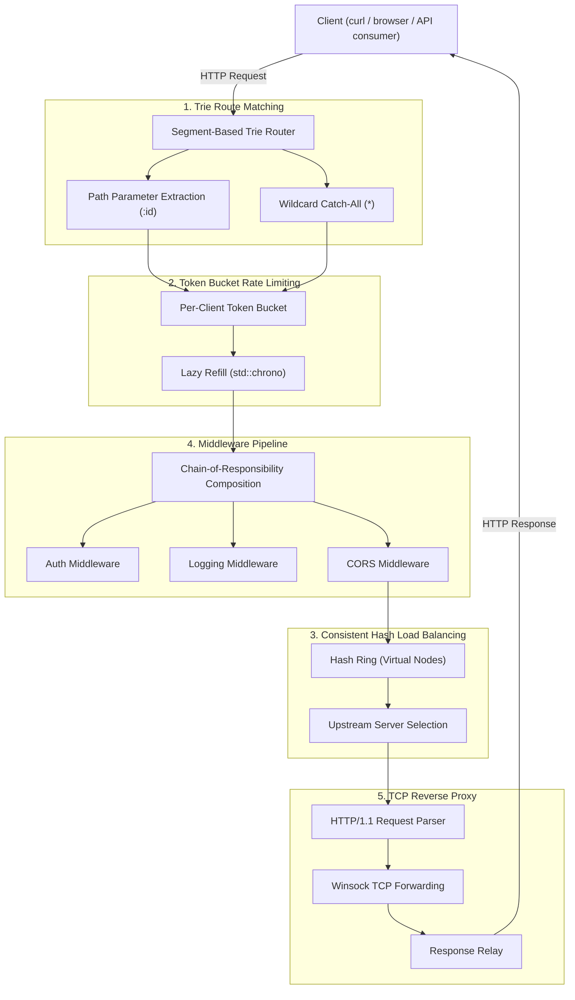

# GatePulse: High-Performance L7 API Gateway & Reverse Proxy

[](https://isocpp.org/)
[](LICENSE)
[]()
[]()

**GatePulse** is a high-performance L7 API gateway and reverse proxy built in modern C++ (C++20). Engineered to demonstrate foundational Computer Science concepts across **Data Structures**, **Operating Systems**, **Computer Networks**, **Distributed Systems**, and **System Design** — with comprehensive learning notes for placement interview preparation.

---

## Architecture Overview



---

## Core Systems Engineering Features

| CS Domain | Feature Implemented | Technical Mechanism |
| :--- | :--- | :--- |
| **Data Structures** | O(k) Trie Route Matching | Segment-based Trie with static/param/wildcard nodes, recursive backtracking with strict priority ordering |
| **System Design** | Token Bucket Rate Limiting | Per-client lazy refill using `std::chrono::steady_clock`, O(1) amortized check |
| **Distributed Systems** | Consistent Hash Load Balancing | Virtual nodes on a 2³²−1 hash ring for upstream server selection |
| **Design Patterns** | Middleware Pipeline | Chain-of-Responsibility with `std::function` composition, compile-time chaining |
| **Computer Networks** | TCP Reverse Proxy | Raw Winsock L7 forwarding with HTTP/1.1 header parsing and connection relay |

---

## Milestone Progress

- [x] **FR1:** Trie Route Matching — Segment-based Trie with param extraction & wildcard support
- [ ] **FR2:** Token Bucket Rate Limiting
- [ ] **FR3:** Consistent Hash Load Balancing
- [ ] **FR4:** Middleware Pipeline
- [ ] **FR5:** TCP Socket Reverse Proxying

---

## Dedicated Learning Notes (Interview Prep)

Every architectural decision and interview "WHY" is documented in depth:
* [01. Trie Routing, Prefix Trees, & Radix Trees](learning/01_trie_routing_and_prefix_trees.md)

---

## Quickstart & Build Instructions

### 1. Run the Full Test Suite
Execute the one-click verification script to compile and run all milestones:
```cmd
run_all_tests.bat
```

### 2. Compile a Single Test
```cmd
build.bat tests/test_trie_router.cpp -o bin/test_trie_router.exe
bin\test_trie_router.exe
```

---

## Build Toolchain

| Component | Version |
| :--- | :--- |
| Compiler | GCC (MinGW-W64) 16.2.0 |
| Standard | C++20 (`-std=c++20`) |
| Platform | Windows x64 |
| Linking | Static (`-static -static-libgcc -static-libstdc++`) |

---

## License

MIT License — see [LICENSE](LICENSE) for details.
